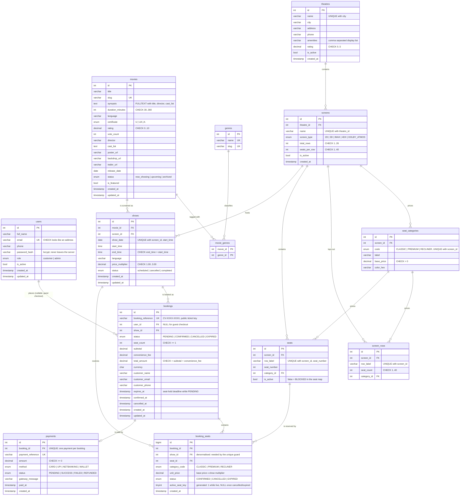

# CINEVERSE — Entity Relationship Diagram

13 tables in **third normal form**, with one deliberate denormalisation
(`booking_seats.show_id`) explained [below](#the-one-deliberate-denormalisation).
The authoritative definition is [`database/schema.sql`](../database/schema.sql).

> **Rendered copy:** [`er-diagram.svg`](er-diagram.svg) — a standalone vector image you can drop
> straight into a report or slide deck. Regenerate it with `npm run er-diagram`, which parses this
> exact Mermaid block with the real Mermaid grammar, so a broken diagram fails the script instead of
> surprising a reader.

---

## Diagram



---

## Relationship notes

| Relationship | Cardinality | Meaning |
|---|---|---|
| `users → bookings` | 1 : 0..N | A booking may belong to a registered user, **or** be a guest checkout (`user_id IS NULL`) — the customer columns are copied onto the booking so a ticket is self-contained. |
| `movies ↔ genres` | M : N via `movie_genres` | A film has several genres and a genre labels many films. Kept as a junction table rather than a comma-separated column (1NF). `ON DELETE CASCADE`. |
| `theatres → screens` | 1 : N | A theatre owns auditoriums; `(theatre_id, name)` is unique. `RESTRICT` on delete. |
| `screens → seat_categories` | 1 : N | Pricing tiers are **per screen** — a recliner in IMAX costs more than one in a small 2D hall. `(screen_id, code)` unique. |
| `screens → screen_rows` | 1 : N | The layout definition: which rows exist and how many seats each holds. Lets an admin regenerate a hall without touching existing bookings. |
| `screens → seats` | 1 : N | The physically bookable seats. `(screen_id, row_label, seat_number)` unique, so a position exists exactly once per hall. |
| `seat_categories → seats` | 1 : N | Each seat inherits its tier's price at show time (tier price × the show's multiplier). |
| `movies → shows` | 1 : N | A film has many screenings. |
| `screens → shows` | 1 : N | A screen hosts many screenings; `(screen_id, show_date, start_time)` is unique so one auditorium cannot start two films at once. |
| `shows → bookings` | 1 : N | A booking is always for exactly one screening. |
| `bookings → booking_seats` | 1 : 1..N | A booking has at least one seat. `ON DELETE CASCADE`. |
| `shows → booking_seats` | 1 : N | Also constrained directly to the show — this is what makes the unique seat guard possible. A trigger refuses lines whose show is not on sale. |
| `seats → booking_seats` | 1 : N | A seat accumulates history: one live line plus any number of cancelled/expired ones. |
| `bookings → payments` | 1 : 0..1 | At most one payment attempt per booking (`UNIQUE booking_id`), so a retry updates instead of duplicating. |

---

## The one deliberate denormalisation

`booking_seats.show_id` duplicates data that is reachable through `bookings.show_id`. It exists so
the double-booking guard can be a **single-table unique index**:

```sql
active_seat_key TINYINT UNSIGNED
  GENERATED ALWAYS AS (CASE WHEN status IN ('CANCELLED','EXPIRED') THEN NULL ELSE 1 END) STORED,

UNIQUE KEY uq_booking_seats_show_seat (show_id, seat_id, active_seat_key)
```

A unique index cannot span a join, so the show id has to live on the row. MySQL treats `NULL`s as
distinct, which gives exactly the semantics we want:

- a **live** line has `active_seat_key = 1` → the second insert of the same seat collides (`ERROR 1062`);
- a **released** line (cancelled or expired) has `active_seat_key = NULL` → unlimited history rows,
  and the seat becomes bookable again immediately.

There is also a trigger keeping the two copies honest, and the API always derives `show_id` from the
booking rather than trusting a client value.

---

## Database-level integrity

**Triggers**

| Name | Effect |
|---|---|
| `trg_booking_seats_show_must_be_scheduled` | `SIGNAL SQLSTATE 45000` if a seat line is added for a cancelled/completed/past screening |
| `trg_bookings_amounts_immutable` | `SIGNAL SQLSTATE 45000` if `subtotal`, `convenience_fee` or `total_amount` is edited after confirmation |

**Stored procedure**

| Name | Effect |
|---|---|
| `sp_release_expired_holds()` | Sweeps `PENDING` bookings past `expires_at` to `EXPIRED` and expires their seat lines, freeing the seats. Returns the number of released seat lines. Called before availability reads and bookings. |

**Views**

| Name | Purpose |
|---|---|
| `vw_show_occupancy` | Per screening: total / booked / available seats and occupancy percentage — powers the "filling fast" badges and the admin dashboard |
| `vw_booking_tickets` | Booking joined to film, theatre, screen, showtime and a `GROUP_CONCAT` of seat labels — one row is a printable ticket |

**CHECK constraints** (representative)

| Table | Constraint |
|---|---|
| `users` | `email LIKE '%_@_%._%'` |
| `movies` | `duration_minutes BETWEEN 30 AND 360`, `rating BETWEEN 0 AND 10` |
| `theatres` | `rating BETWEEN 0 AND 5` |
| `screens` | `total_rows BETWEEN 1 AND 26`, `seats_per_row BETWEEN 1 AND 40` |
| `seat_categories` | `base_price > 0` |
| `shows` | `end_time > start_time`, `price_multiplier BETWEEN 1.00 AND 3.00` |
| `bookings` | `total_amount = subtotal + convenience_fee`, `seat_count >= 1` |
| `payments` | `amount >= 0` |

**Indexes for query paths**

| Index | Serves |
|---|---|
| `ft_movies_search (title, synopsis, director, cast_list)` | `?search=` catalogue queries |
| `uq_shows_screen_slot (screen_id, show_date, start_time)` | Prevents an auditorium being double-scheduled |
| `uq_booking_seats_show_seat` | The double-booking guard |
| `uq_payments_booking` / `uq_payments_reference` | One payment per booking, unique gateway reference |
| `uq_bookings_reference` | Public ticket lookups |

---

## Verified behaviour

These were exercised directly against MySQL 8, not just through the API:

| Action | Result |
|---|---|
| Insert a second **live** `booking_seats` row for the same show + seat | `ERROR 1062` on `uq_booking_seats_show_seat` |
| Insert a seat line on a `completed` show | `ERROR 1644 (45000)` from the trigger |
| Edit `subtotal` on a confirmed booking | `ERROR 1644 (45000)` from the trigger |
| Insert a movie with `duration_minutes = 5` | `ERROR 3819` (CHECK constraint) |
| `CALL sp_release_expired_holds()` | Returns `released_seat_lines` and frees the seats |
| 6 concurrent bookings for the same seat | Exactly 1 winner, 5 × `409 SEATS_UNAVAILABLE`, exactly 1 live row |
